<div align="center">

# AnimeList

**Suivi d'animes local-first pour Windows 11.**
Pas de compte, pas de serveur, pas de pub, pas d'analytics —
toute ta bibliothèque vit dans un fichier sur ton PC.


Auteur : **Zaidal**

</div>

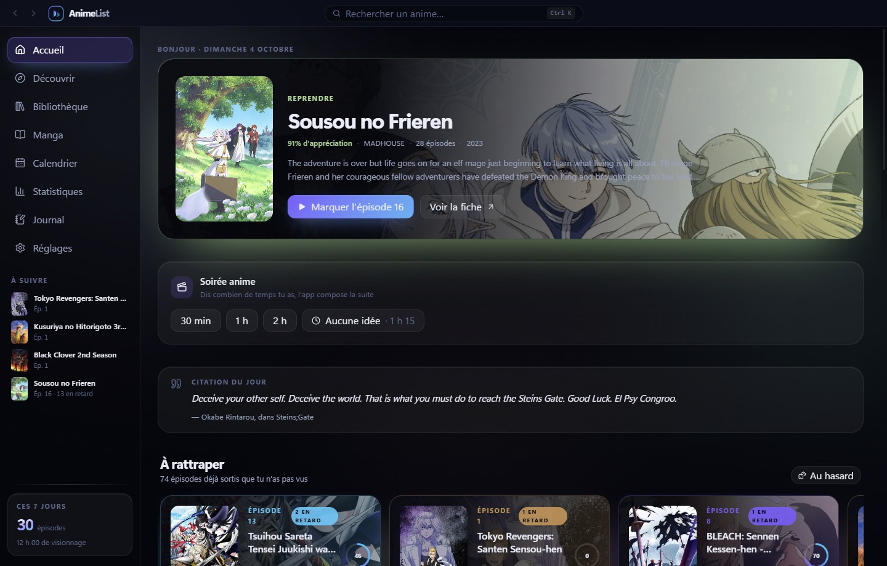

<table>
<tr>
<td width="50%"><a href="docs/screenshots/fiche.jpg">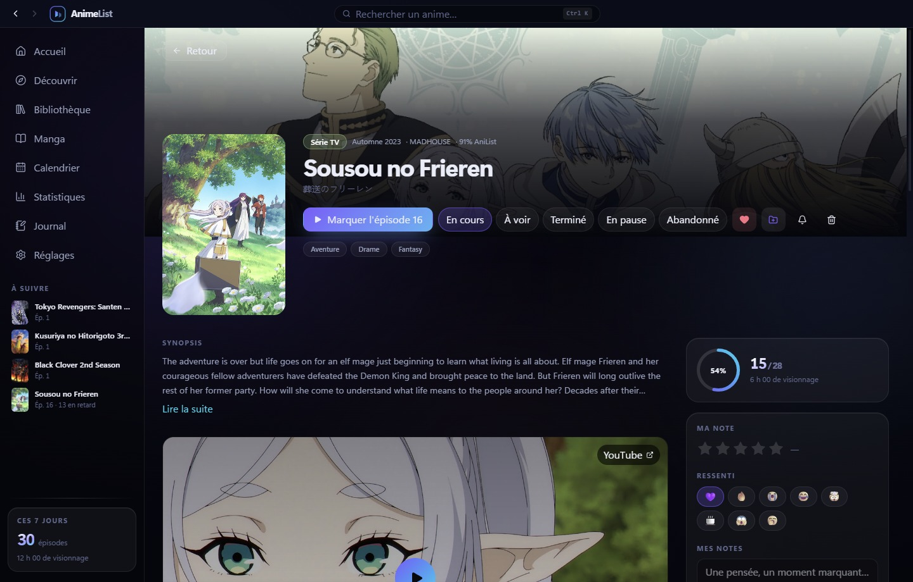</a><br><sub><b>Fiche.</b> Progression, note, ressentis, bande-annonce, casting, relations, recommandations.</sub></td>
<td width="50%"><a href="docs/screenshots/episodes.jpg">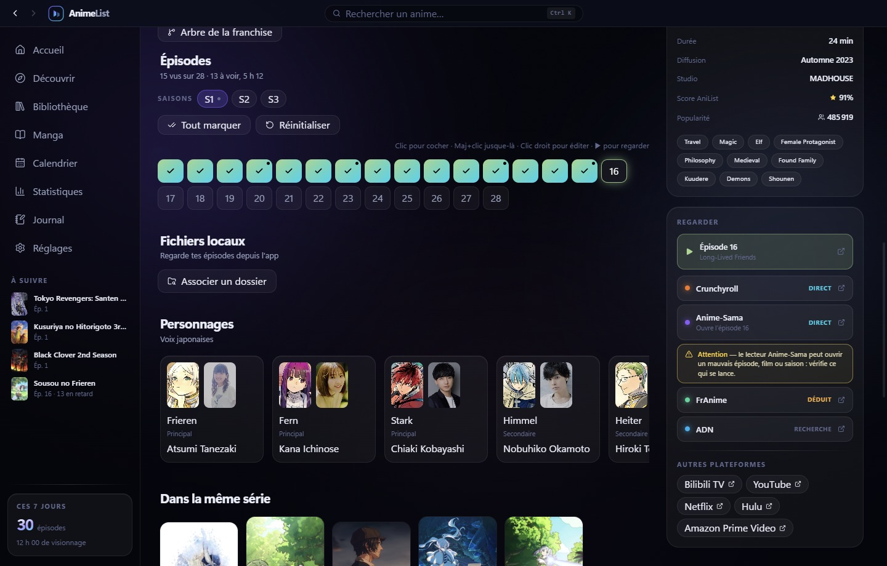</a><br><sub><b>Épisodes.</b> Clic pour cocher, <code>Maj+clic</code> jusque-là, clic droit pour éditer date, durée, ressenti et note.</sub></td>
</tr>
<tr>
<td><a href="docs/screenshots/bibliotheque.jpg">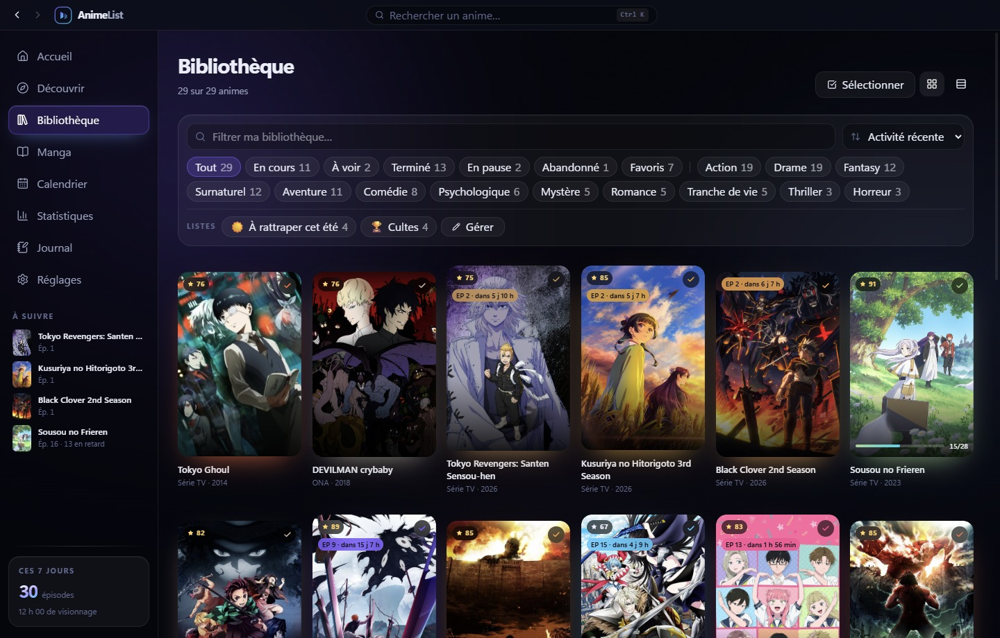</a><br><sub><b>Bibliothèque.</b> Cinq statuts, favoris, filtres, listes personnalisées, actions groupées.</sub></td>
<td><a href="docs/screenshots/statistiques.jpg">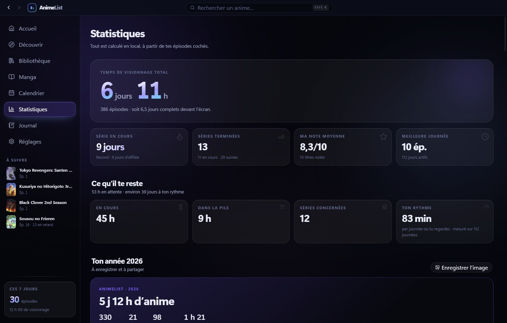</a><br><sub><b>Statistiques.</b> Temps total, séries de jours, heatmap, top genres et studios, cent badges.</sub></td>
</tr>
<tr>
<td><a href="docs/screenshots/decouvrir.jpg">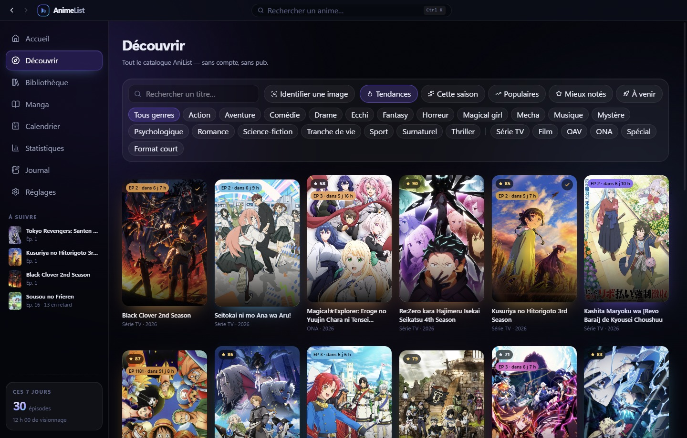</a><br><sub><b>Découvrir.</b> Tout le catalogue AniList : tendances, saison, populaires, à venir, filtres par genre et format. Une image suffit à retrouver la série.</sub></td>
<td><a href="docs/screenshots/saison.jpg">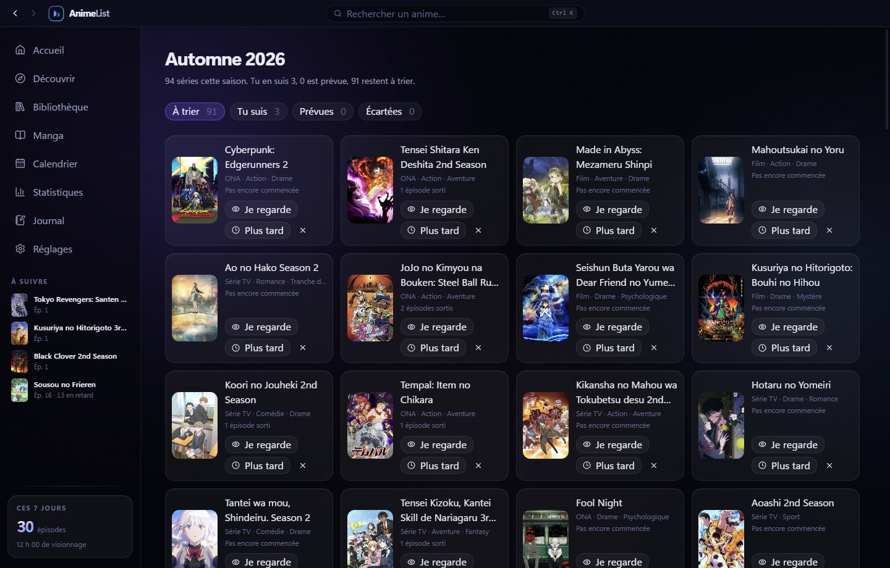</a><br><sub><b>Saison.</b> Les nouveautés à trier d'un clic : « Je regarde », « Plus tard » ou écartée.</sub></td>
</tr>
<tr>
<td><a href="docs/screenshots/calendrier.jpg">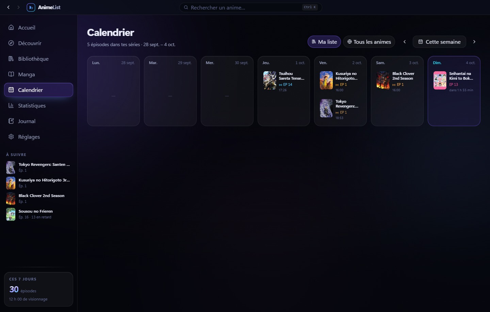</a><br><sub><b>Calendrier.</b> Les sorties de la semaine, pour ta liste ou tout le catalogue, à l'heure de diffusion.</sub></td>
<td><a href="docs/screenshots/journal.jpg">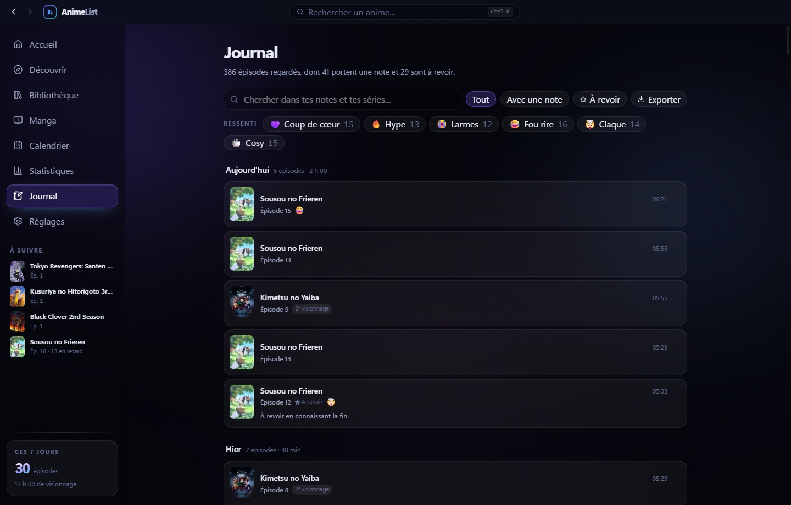</a><br><sub><b>Journal.</b> Chaque épisode regardé, jour par jour : ressentis, notes, revisionnages, épisodes à revoir. Recherche et export.</sub></td>
</tr>
<tr>
<td><a href="docs/screenshots/manga.jpg">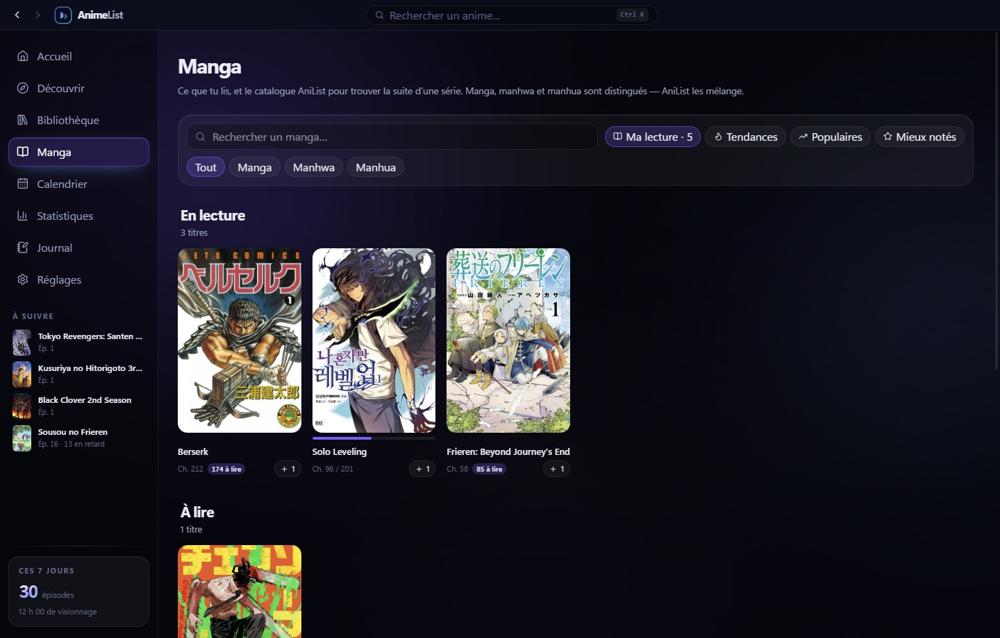</a><br><sub><b>Manga.</b> Ce que tu lis, chapitre par chapitre, et le catalogue pour trouver la suite d'une série. Manga, manhwa et manhua distingués.</sub></td>
<td><a href="docs/screenshots/manga-fiche.jpg">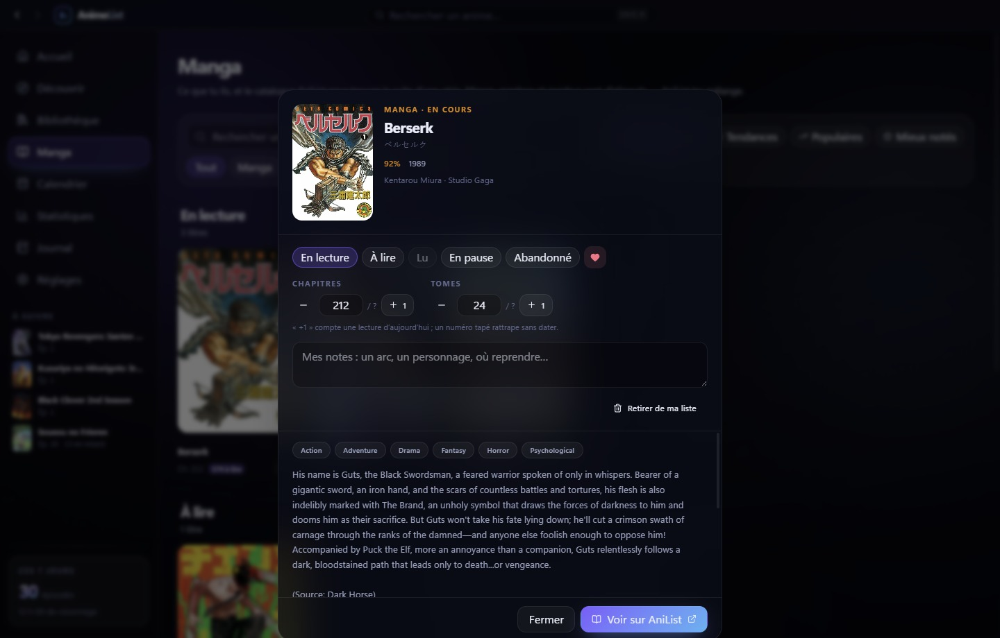</a><br><sub><b>Fiche manga.</b> Statut, chapitres et tomes, notes. « +1 » compte une lecture du jour.</sub></td>
</tr>
<tr>
<td><a href="docs/screenshots/lecture.jpg">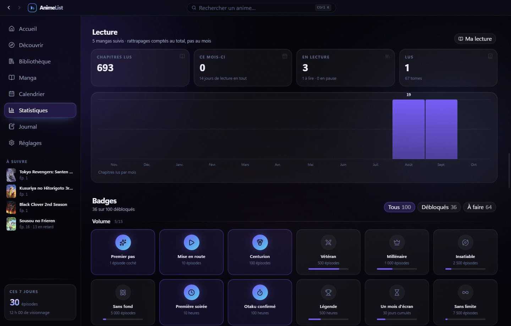</a><br><sub><b>Lecture.</b> Chapitres lus, mangas en cours et finis, chapitres par mois.</sub></td>
<td><a href="docs/screenshots/badges.jpg">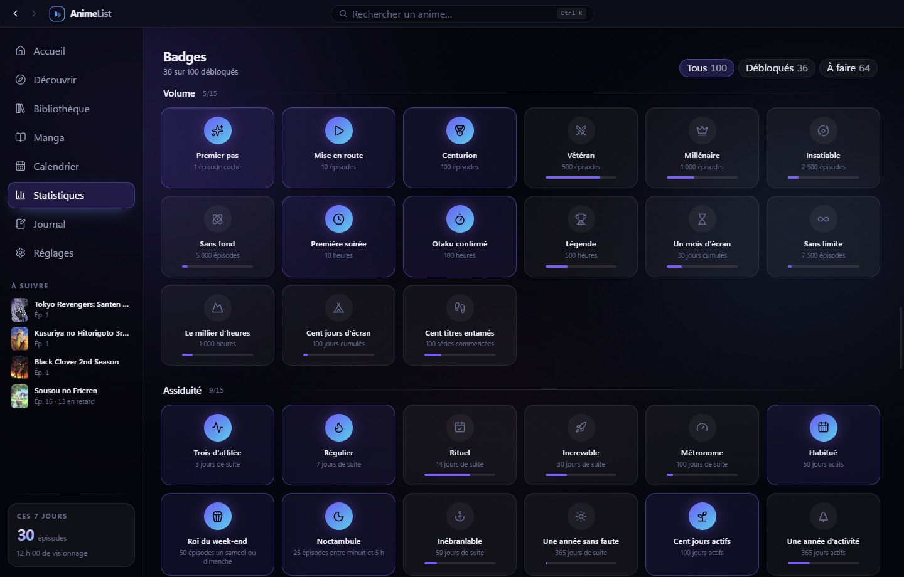</a><br><sub><b>Badges.</b> Cent badges par catégorie, avec la progression vers les suivants.</sub></td>
</tr>
<tr>
<td><a href="docs/screenshots/reglages.jpg">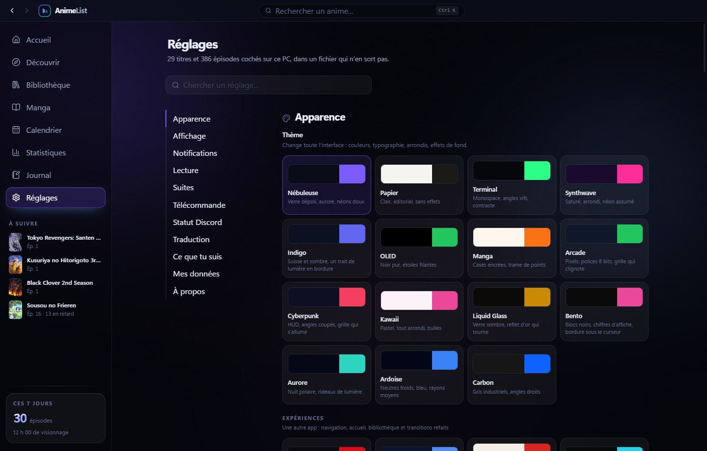</a><br><sub><b>Réglages.</b> Quinze thèmes et cinq expériences qui refont l'app entière. Chaque réglage se cherche.</sub></td>
<td><a href="docs/screenshots/reglages-bas.jpg">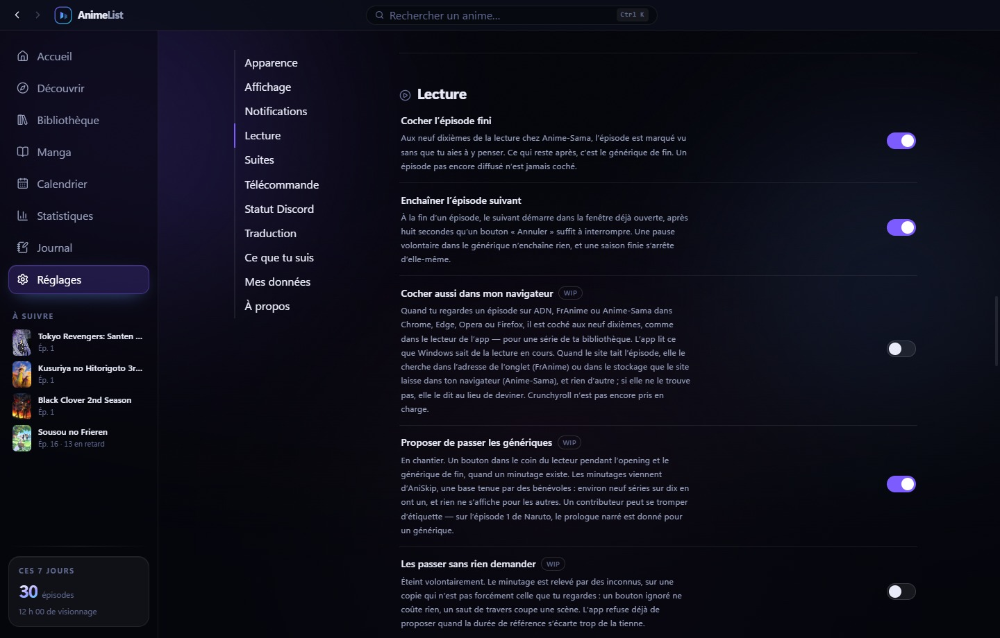</a><br><sub><b>Automatismes.</b> Cocher l'épisode fini, enchaîner le suivant, passer les génériques : chacun se coupe.</sub></td>
</tr>
</table>

<sub>Les captures sont générées sur une bibliothèque de démonstration : les fiches viennent du
catalogue public AniList, la progression et les dates sont inventées. La vraie bibliothèque n'est
jamais lue — ce dépôt est public et un historique de visionnage est personnel.</sub>

## Ce que ça fait

**Suivre** — grille d'épisodes cliquable, cinq statuts, notes par demi-point, ressentis et notes
libres au niveau de la série comme de chaque épisode. Les revisionnages gardent chacun leur date,
leur durée et leurs ressentis. L'historique se corrige.

**Découvrir** — tendances, saison en cours, calendrier des sorties, casting, relations. La rangée
« Pour toi » classe le catalogue selon ce que tu regardes et ce que tu notes, et dit pourquoi
chaque titre est là. Une capture d'écran collée dans « Découvrir » retrouve la série, l'épisode et
la seconde exacte.

**Regarder** — chaque fiche mène à Crunchyroll, Anime-Sama, FrAnime ou ADN, à l'épisode près et
non seulement à la série. Les fichiers vidéo locaux se lisent dans l'app, reprennent où on les
avait laissés et se cochent tout seuls.

**Depuis le téléphone** — un serveur local, un QR code à scanner, et la bibliothèque tient dans
la poche : cocher un épisode, en choisir un autre, lancer le lecteur ou une bande-annonce sur le
PC, régler le volume et la position. Éteint par défaut, protégé par un mot de passe qui change à
chaque allumage.

**Sans rien ressaisir** — import depuis MyAnimeList, TV Time, ou simplement un pseudo AniList ou
Kitsu. Résumés et titres d'épisodes traduits en français avec une clé DeepL.

**Sans y penser** — un épisode regardé sur Anime-Sama se coche tout seul aux neuf dixièmes, et
le suivant s'enchaîne dans la fenêtre déjà ouverte, après huit secondes qu'un bouton suffit à
interrompre. Les deux se coupent dans les réglages.

**Sur Discord** — ton profil peut annoncer la série, l'épisode, la jaquette et le
temps restant, pendant une lecture seulement. Éteint par défaut : c'est la seule
chose ici qui sorte du PC d'elle-même. Un mode discret n'annonce que « un anime ».

**Intégré à Windows** — liste de raccourcis sur l'icône de la barre des tâches, touches multimédia
du clavier pendant une lecture, mini-lecteur flottant, mises à jour automatiques.

## Démarrer

```bash
npm install
npm run dev      # développement, HMR sur le renderer
npm start        # lance la version buildée
npm run build    # typecheck + bundles de production
npm run dist     # installeur Windows (NSIS) dans release/
```

Développé et vérifié sur **Node 24.18.0 / npm 11.16.0**.

## Raccourcis

| Touche | Action |
|---|---|
| `Ctrl+K` | Palette de recherche (bibliothèque + AniList + navigation) |
| `Alt+←` | Retour |
| `Maj+clic` sur un épisode | Cocher tous les épisodes jusque-là |
| Clic droit sur un épisode | Éditer ses visionnages : date, durée, ressenti, note |
| `?` | L'aide des raccourcis, dans l'app |

## Où sont mes données

```
%APPDATA%\animelist\animelist.json              # bibliothèque, préférences, listes
%APPDATA%\animelist\animelist-history.jsonl     # un épisode vu par ligne
%APPDATA%\animelist\anilist-cache.json          # cache réseau (supprimable sans risque)
```

Deux fichiers, chacun écrit de façon atomique avec une copie de secours. L'historique est séparé
parce que les deux moitiés changent à des rythmes très différents : cocher un épisode ajoute une
ligne au journal au lieu de re-sérialiser des milliers d'entrées.

Réglages → *Mes données* → **Ouvrir** t'y dépose. L'export produit exactement le même format que
le fichier principal : c'est ta sauvegarde.

## Pour aller plus loin

**[docs/technique.md](docs/technique.md)** — architecture, design, tests, et les décisions qui
demandent une explication : pourquoi un script maison installe Electron, pourquoi la
bande-annonce passe par un serveur local, comment régénérer les captures et publier une version.

`PRODUCT.md` consigne la vérité produit — usagers, contraintes, principes — sans aucune décision
visuelle. `CHANGELOG.md` est la source des notes affichées dans l'app.

## Licence

Projet personnel, non distribué. Les données d'anime proviennent de l'API publique
[AniList](https://anilist.co) et appartiennent à leurs auteurs respectifs.
